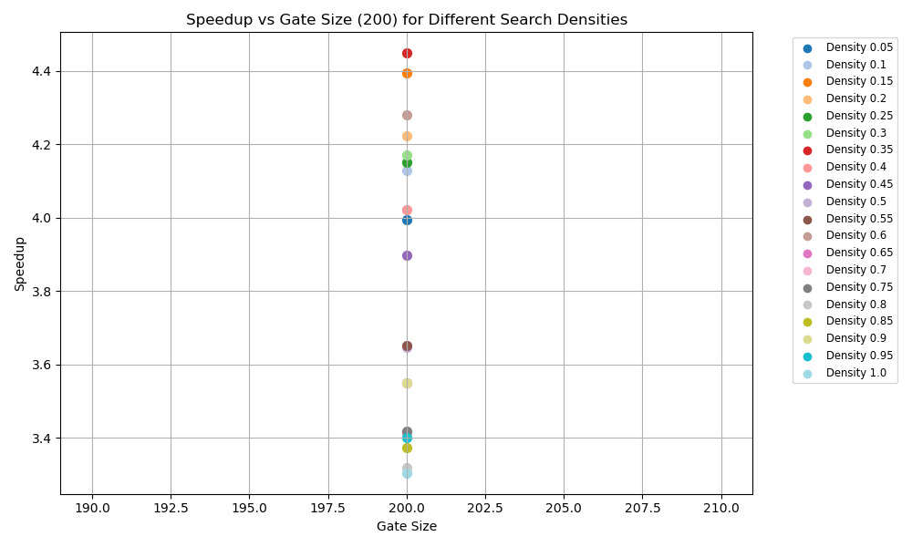
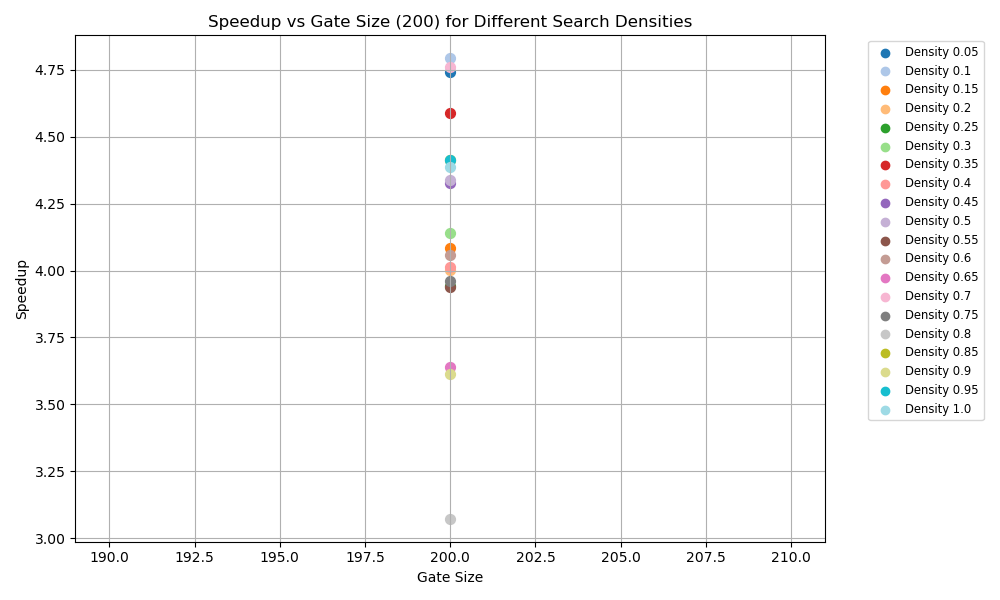
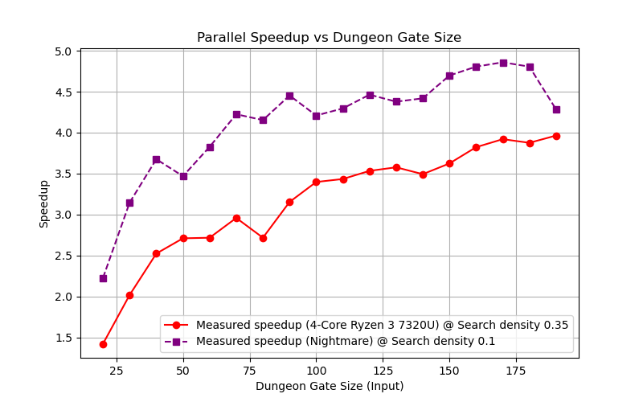

# CSC2002S Assignment PCP1 ~ Adam Foflonker

## Preamble

### The Parallel Implementation
The parallel version of the serial implementation of `SoloLevelling` was implemented by **parallelizing** the `Hunt` and `DungeonHunter` classes into `HuntParallel` and `DungeonHunterParallel` respectively. The `DungeonMapParallel` class serves as a *fork* of the `DungeonMap` class with differing semantics but identical functionality and structure.

### Profiling
Since *Automark* only allows `3` **Java** source files to be submitted, and the two profilers were written in **Java**, they were renamed to a different extension, namely: `Profiler.java.txt` and `SearchDensityProfiler.java.txt`. To run the profilers, the *'.txt'* extension must be removed from their names and all *profiler build targets* in the *Makefile* must be uncommented.

## Methods

### Validation
To ensure a proper comparison between the *serial* and *parallel* implementations, an output validation technique had to be employed. However, due to the *benign race conditions* present in the *parallel* implementation, simply comparing textual output wasn't enough. To ensure the correctness of the *parallel* implementation, a short program named `ImageCompare` was written in `C++`, which was used to validate the *parallel* implementation against the *serial* implementation by means of the `CompareSearchMaps.py` Python script:
``` Python
myDir = os.path.dirname(os.path.abspath(__file__))
projRoot = os.path.abspath(os.path.join(myDir, ".."))
os.chdir(projRoot)

subprocess.run(
    ["make", "-C", "./ImageCompare", "run", "ARGS=../bin/Serial/visualiseSearch.png ../bin/Parallel/visualiseSearch.png"],
    check = True, text = True)
print()
subprocess.run(
    ["make", "-C", "./ImageCompare", "run", "ARGS=../bin/Serial/visualiseSearchPath.png ../bin/Parallel/visualiseSearchPath.png"],
    check = True, text = True)
```

This script takes both search maps generated by the *serial* and *parallel* implementations respectively and passes them in pairs to `ImageCompare` which checks to see if each and every byte of the two respective images are exactly the same. If they are the same, the *parallel* implementation is valid, otherwise not.

### Optimum Search Density
Determining the **optimum search density** was done by writing a `Java` program named `SearchDensityProfiler`. This program works by testing every search density between `0-1` with a **step** of `0.05` at a constant **gate size** of `200` and **random seed** set to `627` - and measures each of these tests 5 times. This profiler also considers **JVM warm-up time** by running `3` tests before taking measurements and using the same instance of the **JVM** for all tests. It also manually invokes the **garbage collector** in-between tests to minimize any effects that caching may have on testing.

``` Java
// Warm-up phase
for (int i = 0; i < WARMUP_ITERATIONS; ++i)
    RunTest(i, null); // Pass a null writer to ignore these timings

for (int i = 0; i < SEARCH_DENSITIES.length; ++i)
{
    for (int j = 0; j < MEASURE_ITERATIONS; ++j)
    {
        RunTest(i, writer);
        System.gc();
    }
}
```

The profiler then writes the results of these tests to a **CSV** file which can be used to plot a graph in `Python` using `Matplotlib`. We can then identify the **optimal search density** for a specific machine by reading the 'highest' point on the graph.

Optimal search density plot for my *4-Core AMD Ryzen 3 7320U*:


Optimal search density plot for *Nightmare*:



### Benchmarking
Benchmarking was handled by writing a `Java` program named `Profiler`. Similarly to `SearchDensityProfiler`, this program also considers **JVM warm-up time** and runs `3` warm-up iterations before taking measurements while also using a **random seed** of `627`, and invokes the **garbage collector** between tests. The `Profiler` runs tests starting from a **minimum gate size** of `20` up to a **maximum gate size** of `200` - measuring each test `10` times. The `Profiler` uses the **optimal search density** determined by the `SearchDensityProfiler` for all tests.

``` Java
// Warm-up phase here
for (int i = 0; i < WARMUP_ITERATIONS; ++i)
    RunTest(i, MIN_GATE_SIZE, SEARCH_DENSITY, null); // Pass a null writer to ignore these timings

for (int gateSize = MIN_GATE_SIZE; gateSize < MAX_GATE_SIZE; gateSize += GATE_SIZE_STEP)
{
    for (int i = 0; i < MEASURE_ITERATIONS; ++i)
        RunTest(i, gateSize, SEARCH_DENSITY, writer);
}
```

The profiler then writes the results of these tests to a **CSV** which can be used to plot two sets of graphs in `Python` using `Matplotlib` - one being the results from *Nightmare*, and the other being from any other machine.

Benchmarking was performed on:
- 4-Core AMD Ryzen 3 7320U
- Nightmare server (via SSH)
- 6-Core Intel i5-9400F (only for reference, not included in final results)

In this experiment the **sequential cutoff** was deliberately set to `1` to isolate and measure the pure overhead and scalability of the `ForkJoin` parallel decomposition. By forcing every individual element to be handled as a *separate task*, the algorithm maximizes *task granularity* stressing the parallel framework however, in practice, a *larger cutoff* would likely yield much better performance.

## Results

### Validation
Below is the terminal output from running the `CompareSearchMaps.py` script which uses the `ImageCompare` program to check if the images generated by the *serial* and *parallel* implementations are identical:
``` txt
┌──(adam⚡AdamLaptop)-[~/UCT/Main Courses/CSC2002S/Assignments/PCP1]
└──$ python Scripts/CompareSearchMaps.py
make: Entering directory '/mnt/c/Users/Adam/source/repos/ComputerScienceUCT-Private/Main Courses/CSC2002S/Assignments/PCP1/ImageCompare'
mkdir -p ../bin/ImageCompare/intermediate
g++ -std=c++20 -Wall -Wextra -I . -c Main.cpp -o ../bin/ImageCompare/intermediate/Main.o
g++ -std=c++20 -Wall -Wextra -I . -o ../bin/ImageCompare/ImageCompare ../bin/ImageCompare/intermediate/Main.o
./../bin/ImageCompare/ImageCompare ../bin/Serial/visualiseSearch.png ../bin/Parallel/visualiseSearch.png
Comparing images...

The two images are equal.
make: Leaving directory '/mnt/c/Users/Adam/source/repos/ComputerScienceUCT-Private/Main Courses/CSC2002S/Assignments/PCP1/ImageCompare'

make: Entering directory '/mnt/c/Users/Adam/source/repos/ComputerScienceUCT-Private/Main Courses/CSC2002S/Assignments/PCP1/ImageCompare'
./../bin/ImageCompare/ImageCompare ../bin/Serial/visualiseSearchPath.png ../bin/Parallel/visualiseSearchPath.png
Comparing images...

The two images are equal.
make: Leaving directory '/mnt/c/Users/Adam/source/repos/ComputerScienceUCT-Private/Main Courses/CSC2002S/Assignments/PCP1/ImageCompare'
Press Enter to continue...
```

### Benchmarking
Below is the **speedup plot** for *my laptop (Ryzen 3 7320U)* and the *Nightmare server* plotted on the same set of axes. All tests on *my laptop* were done using the **optimal search density** of `0.35`, and similarly, `0.1` was used for *Nightmare*:

> `Speedup = SerialTime / ParallelTime`

### Discussion
The *parallel* implementation performs well for input sizes *(gate sizes)* above `20`. Therefore, in a practical application, it would prove beneficial to use a *sequential cutoff* of `20` as well.

The **maximum speedup** obtained on *my laptop* was just under `4.0`. This is as expected as the **maximum theoretical speedup** *on *my laptop* is `4.0` since it has `4` **cores**.

The **maximum speedup** obtained on *Nightmare* is around `4.8`. This is higher than initially expected as, at a glance, the **maximum theoretical speedup** is only `4.0` due to *Nightmare* having `4` **cores** hence, it appears that **superlinear speedup** is being observed. However, this is **not** the case. This is actually easily explainable due to **Intel Hyper-threading**; *Nightmare* has an *Intel Xeon E5620* which has `4` **physical cores**, with each core having `2` **threads**, which will allow `ForkJoin` to create a pool of up to `8` **threads**, instead of `4`. Therefore, the actual **maximum theoretical speedup** as reported by `Runtime.getRuntime().availableProcessors()`, is `8`.

These measurements are reliable as the same versions of `Profiler` and `SearchDensityProfiler` were used across all target machines. And considering that the profilers **warmed up the JVM** before taking measurements further improves the reliability of the measurements.

### Conclusion
It is **most definitely** worth it to use *parallelization* to solve this problem!
