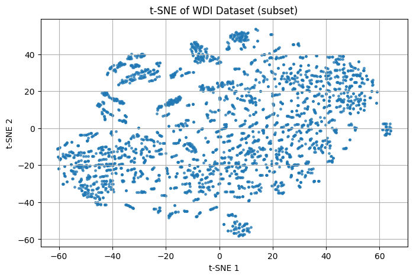
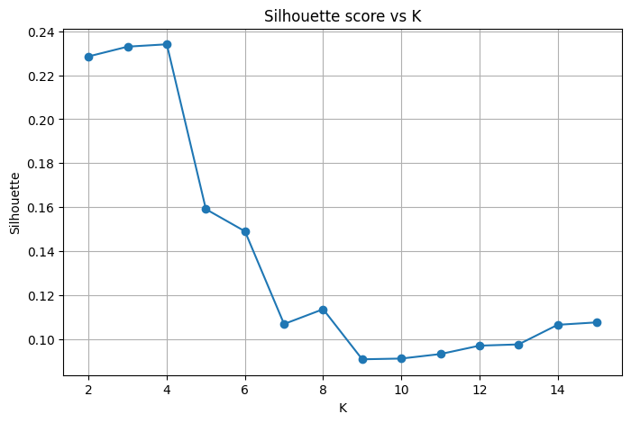
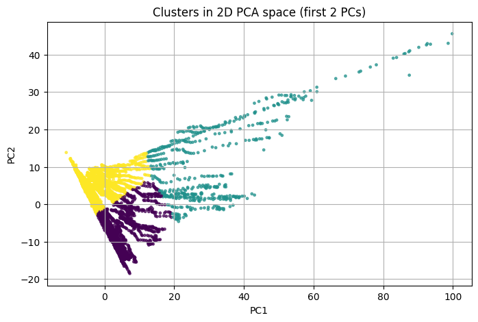
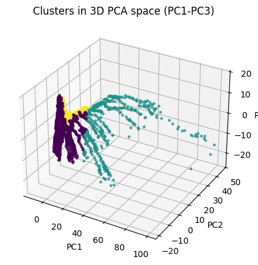

# CSC2042S Assignment 1 ~ Adam Foflonker

## **Preamble**

### **3rdParty Libraries Used**
- NumPy
- Pandas
- Scikit-Learn
- Matplotlib

### **Running the Notebook**
Prerequisites for running `notebook-assignment1.ipynb`:
- Aforementioned 3rdParty libraries must be installed.
- The **WDICSV.csv** dataset must be placed in `"data/WDICSV.csv"` - relative to `notebook-assignment1.ipynb`. Note that the `"data/"` directory has been ignored by git.

### **Global Constants, State and Flags**
``` Python
DATA_PATH: Path = Path("./data/WDICSV.csv")
RANDOM_STATE: int = 42

plt.rcParams.update({ "figure.figsize": (8, 5), "axes.grid": True })
np.random.seed(RANDOM_STATE)

# Feature name constants
FEATURE_BASE_COUNTRY_NAME: str = "Country Name"
FEATURE_BASE_COUNTRY_CODE: str = "Country Code"
FEATURE_BASE_INDICATOR_NAME: str = "Indicator Name"
FEATURE_BASE_INDICATOR_CODE: str = "Indicator Code"

FEATURE_BASE_COUNTRY_ALL: list[str] = [FEATURE_BASE_COUNTRY_NAME, FEATURE_BASE_COUNTRY_CODE]
FEATURE_BASE_INDICATOR_ALL: list[str] = [FEATURE_BASE_INDICATOR_NAME, FEATURE_BASE_INDICATOR_CODE]
FEATURE_BASE_ALL: list[str] = FEATURE_BASE_COUNTRY_ALL + FEATURE_BASE_INDICATOR_ALL

FEATURE_DERIVED_YEAR: str = "Year"

# Feature filtering thresholds
MIN_FEATURE_COVERAGE: int = 0.60  # Keep features with >= 60% (non-NaN)
MIN_SAMPLE_COVERAGE: int = 0.70   # Keep samples (country-year) with >= 70% (non-NaN)

# The best K-value to use for clustering as determined by the silhouette score in section 6
BEST_K: int = 4
```
---

## **Machine Learning Pipeline Tasks**

### **Data Preprocessing**
For preprocessing, all features with greater than `60%` coverage were kept, and all samples with greater than `70%` coverage were kept as well. The rest were either discarded or computed using *median imputation*. The **median** was used instead of the *mean* as it works better for outliers and in general practice in the real world. Scaling was applied to all data points using `sklearn.preprocessing`.

### **Visualization with t-SNE**
Visualization was done using t-SNE. Since the input data set is quite large, only a **subset** of the data points were visualized, as seen below:


### **K-Means Clustering**
A custom implementation of **K-Means Clustering** was implemented using **NumPy**. Both random initialization and **K-Means++** were implemented however, only **K-Means++** was used for the final clustering.

### **Convergence Criteria**
`4` Different convergence criterions were tested, namely:
- `max_iters_only`: Tests the convergence purely against the `max_iters` parameter.
- `centroid_tol`: Tests the convergence against the centroid shift tolerance.
- `inertia_tol`: Tests the convergence for inertia tolerance.
- `early_patience`: Tests the convergence under early-stopping conditions.

The printed results of these convergence tests are as follows:
``` lua
max_iters_only -> iters: 40 , inertia: 1864980.45
centroid_tol -> iters: 40 , inertia: 1864980.45
inertia_tol -> iters: 40 , inertia: 1864980.45
early_patience -> iters: 40 , inertia: 1864980.45
```
### **Determining the Optimal-K**
Determining the **optimal-K** was done by plotting an *elbow* and a *silhouette* plot. From the *silhouette* plot in particular, it was determined that the **optimal-K** value is `4`.

#### Silhouette score plot:


### **Dimensionality Reduction**
Dimensionality reduction was done using **PCA** - configured to use `14` principal components, as determined optimal by the **elbow curve plot** seen earlier. From **PCA**, we are able to view the top features for each **principal component**:
``` R
Explained variance ratio (first 14): [0.2742 0.2049 0.0516 0.0396 0.0269 0.0238 0.0213 0.0188 0.0156 0.0146
 0.0138 0.0112 0.0109 0.0101]
Top features for PC1:
   SP.POP.65UP.FE.IN  |  Population ages 65 and above, female  | weight= 0.1087
   SP.POP.65UP.TO  |  Population ages 65 and above, total  | weight= 0.1084
   EN.GHG.CO2.MT.CE.AR5  |  Carbon dioxide (CO2) emissions (total) excluding LULUCF (Mt CO2e)  | weight= 0.1081
   EN.GHG.ALL.MT.CE.AR5  |  Total greenhouse gas emissions excluding LULUCF (Mt CO2e)  | weight= 0.1081
    ...
Top features for PC2:
   SP.POP.0014.TO.ZS  |  Population ages 0-14 (% of total population)  | weight= 0.1131
   SP.POP.0014.MA.ZS  |  Population ages 0-14, male (% of male population)  | weight= 0.1128
   SP.POP.0014.FE.ZS  |  Population ages 0-14, female (% of female population)  | weight= 0.1118
   SP.POP.0509.MA.5Y  |  Population ages 05-09, male (% of male population)  | weight= 0.1114
   ...
Top features for PC3:
   SP.POP.2529.FE.5Y  |  Population ages 25-29, female (% of female population)  | weight= 0.1968
   SP.POP.2529.MA.5Y  |  Population ages 25-29, male (% of male population)  | weight= 0.1946
   SP.DYN.CDRT.IN  |  Death rate, crude (per 1,000 people)  | weight= -0.1682
   SP.POP.3034.FE.5Y  |  Population ages 30-34, female (% of female population)  | weight= 0.1597
   ...
Inertia (original): 2083608.43
Inertia (PCA 6D): 886916.45
```

We can then view the clusters in both **2D** and **3D** space:



Well-defined and grouped clusters can be observed from these plots.

### **Cluster Interpretation**
On interpretation of these clusters, **cluster representatives** were determined:
``` R
Cluster 0 representatives:
  Bahamas, The (BHS) - 2013
  New Caledonia (NCL) - 2017
  Bahamas, The (BHS) - 2014
  ...
Cluster 1 representatives:
  Upper middle income (UMC) - 2016
  Upper middle income (UMC) - 2014
  Upper middle income (UMC) - 2015
  ...
Cluster 2 representatives:
  Thailand (THA) - 1977
  Mongolia (MNG) - 1988
  Mongolia (MNG) - 1986
  ...
  ```

### **References**
- ChatGPT: Debugging, pipeline overview, results/output verification.
