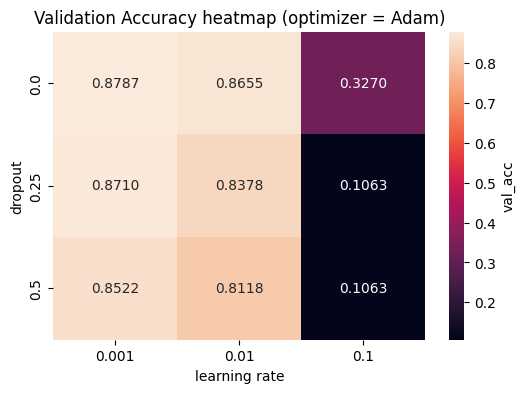
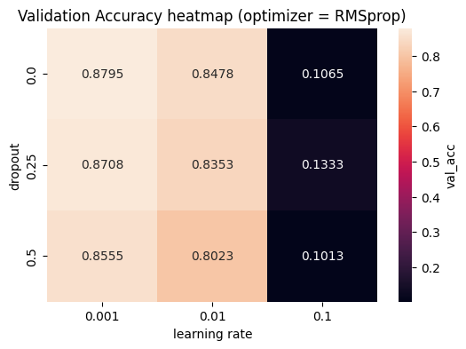
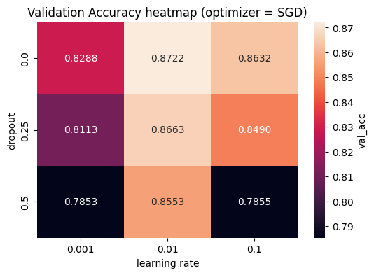
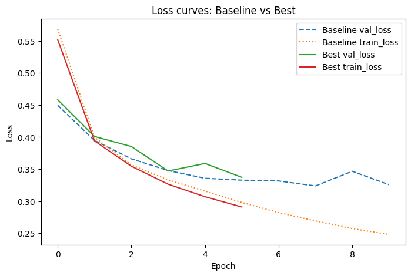
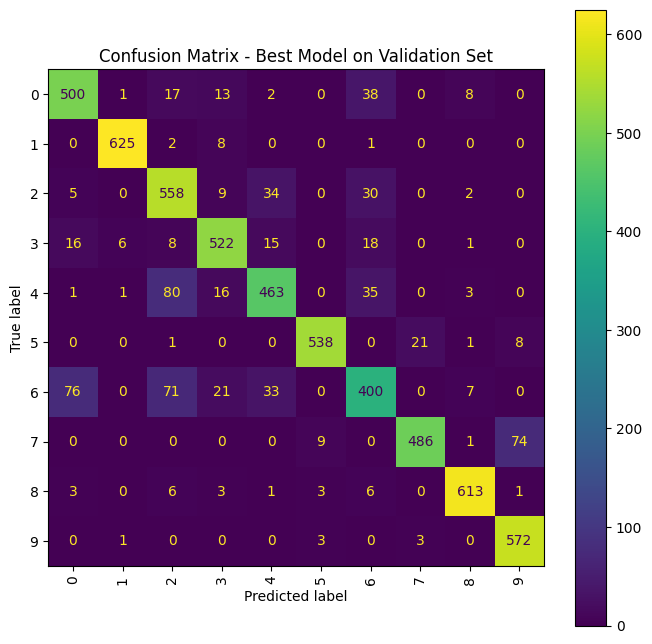

# CSC2042S Assignment 4 ~ Adam Foflonker

## **Preamble**

### **3rd Party Libraries Used**

- Pandas
- NumPy
- Scikit-Learn
- PyTorch
- Torchvision
- Matplotlib
- Seaborn

### **Running the Notebook**

- Please open and run `notebook-assignment4.ipynb`.

### **Global Constants, State and Flags**

A constant *random state* was defined to ensure code reproducibility across different machines. The following hyperparameters were defined as well:
``` python
BATCH_SIZE: int = 128
BASELINE_EPOCHS: int = 10
BASELINE_LR: float = 0.001
RANDOM_SEED: int = 42

random.seed(RANDOM_SEED)
np.random.seed(RANDOM_SEED)
torch.manual_seed(RANDOM_SEED)
torch.cuda.manual_seed_all(RANDOM_SEED)
```

---

## **Tasks**

### **Data Processing**

The **Fashion_MNIST** dataset was loaded using `torchvision.datasets.FashionMNIST(download = True)` by default. This downloads the dataset into the `./data/` folder relative to the notebook.

The dataset was then transformed into *tensors* which were normalized into the `[-1,1]` range.

### **Building & Training a Baseline Model**

A **Multi-Layer Perceptron** class was implemented named `MLP` which has the following methods:
- `def __init__(self, input_size, hidden1, hidden2, num_classes = 10, activation = nn.ReLU, dropout = 0.0)`
- ` def forward(self, x)`

The baseline model was trained for multiple epochs using **mini-batching**  with the **Adam optimizer** and a **fixed learning rate**. Each batch involved a forward pass, loss computation using **cross-entropy**, **backpropagation**, and parameter updates by **Adam**. After each epoch, performance was evaluated on a held-out validation set. The model with the **highest validation accuracy** was retained, and **per-epoch loss** and **accuracy** were recorded for both training and validation.

### **Analysis**

After grid-search hyperparameter tuning, the following best hyperparameters were determined:
- Learning rate: **0.001**
- Optimizer: **RMSprop**
- Dropout: **0.0**

The **best model** with these parameters yielded a validation accuracy of **0.8795**.

The **baseline model** however, had a final validation accuracy of **0.8857**, which is slightly higher than the **best model**. This is likely due to the fact that the **baseline model** was trained using **10 epochs** whereas the **best model** was trained using **6 epochs** to speedup the grid search (which took between **60-90** minutes).

From inspection of the validation accuracy heatmaps after grid search, it appears that changing the **learning rate** hyperparameter had the biggest influence on model performance.

<p align="center">
  
  
  
</p>

On inspection of the loss curves below, we can see the following with respect to the **baseline** and **best** models:

> **Baseline model**: Its training loss keeps dropping steadily, while the validation loss flattens and shows a small uptick near the end. This gap between training and validation losses means the baseline is starting to overfit - it's memorizing noise instead of generalizing properly.

> **Best model**: Both training and validation losses decrease together, staying close throughout training. The small, consistent gap shows mild fitting to the training set but not extreme overfitting nor underfitting. This indicates that the model is generalizing quite well.



<br>
<br>
<br>
<br>
<br>
<br>
<br>
<br>
<br>
<br>
<br>
<br>
<br>
<br>
<br>
<br>
<br>
<br>
<br>
<br>

#### Error Analysis



From the above confusion matrix, it can be seen that classes **2** and **4** are often confused as well as classes **0** and **6**. This is likely due to their images sharing many of the same pixel values or similar shapes, making them easier to be confused.
