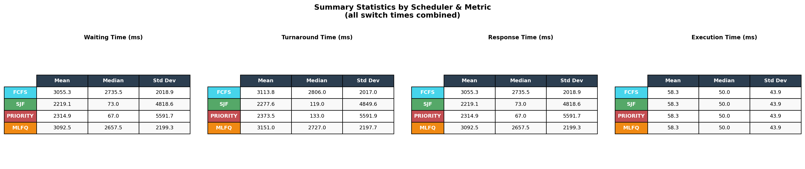
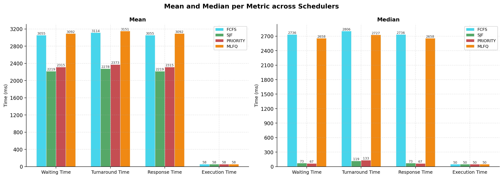
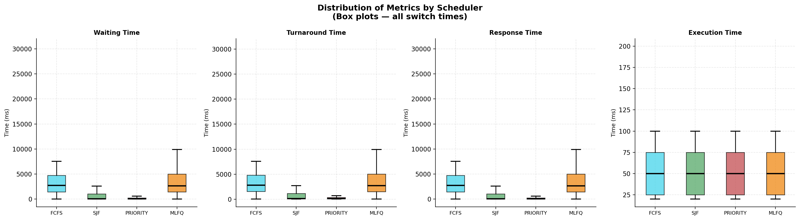
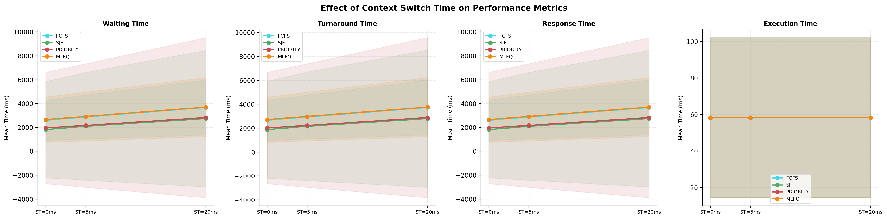
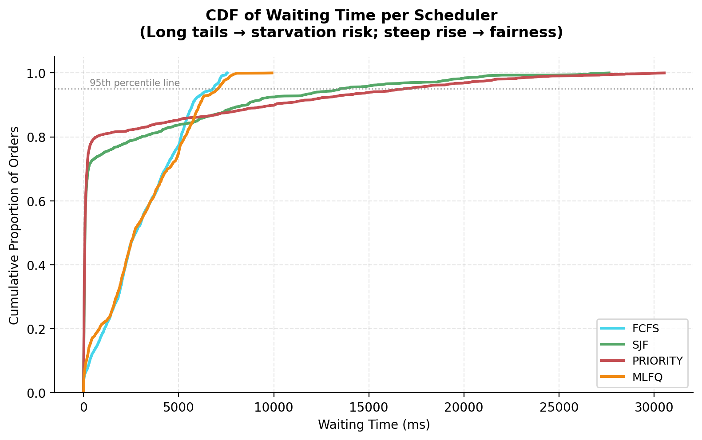
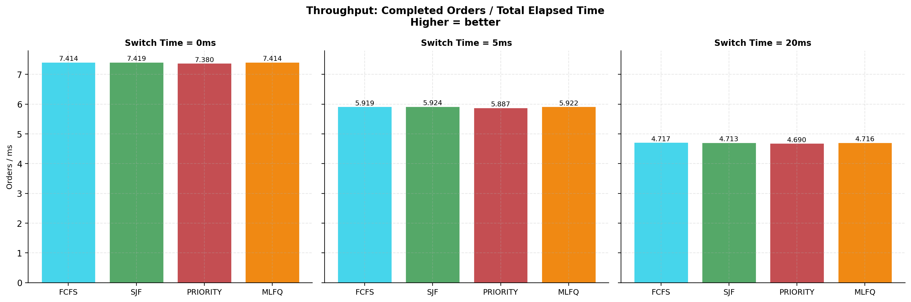
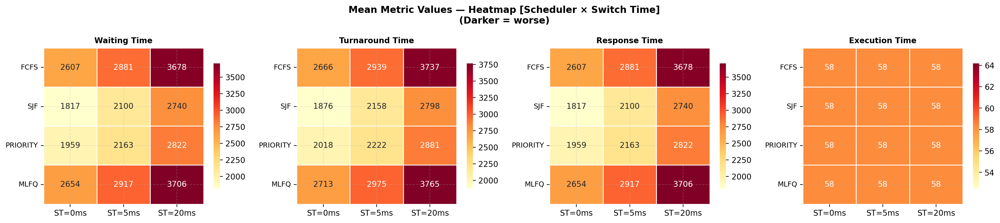

# CSC3002F Assignment OS2 ~ Adam Foflonker

## Preamble

This report details the methods and results used to profile and compare several **CPU Scheduling** algorithms, namely:

- **First-Come First-Serve** (FCFS)
- **Shortest Job First** (SJF)
- **Priority**
- **Multilevel Feedback Queue** (MLFQ)

All algorithm simulation, testing and data collection was performed via the **"Allegra The Barman"** simulation.

---

## Methods

### Recording

To record the required data, the `void recordCompletedOrder(DrinkOrder order)` function in `Barman.java` was implemented to emit `DrinkOrder` information into a CSV file. The CSV files are named according to the format: `"{scheduler_name}_ST{switch_time}.csv"`. All CSV files are saved to the [results](./results/) folder, relative to the project's root.

> **Note:** If the CSV file for the current test (scheduler + switch time) already exists, the new `DrinkOrder` data is appended into it.

The metrics recorded in each CSV file are:

- **PatronID**: `int`
- **Drink**: `string`
- **ArrivalTime**: `long`
- **StartTime**: `long`
- **CompletionTime**: `long`
- **ExecutionTime**: `long`
- **WaitingTime**: `long`
- **ResponseTime**: `long`
- **TurnaroundTime**: `long`
- **QueueLevel**: `int`
- **Priority**: `int`

> **Important:** The `recordCompletedOrder` function must be marked as `synchronized` since it performs **I/O** operations and can be called from multiple threads.

To actually record the data, the simulation was run multiple times on a range of different inputs using the shell script [tests.sh](tests.sh):

``` bash
readonly SEED=42

for sched in 0 1 2 3
do
    for patrons in 10 50 100
    do
        for switchTime in 0 5 20
        do
            echo "Running Scheduler $sched:"
            echo "  Patrons: $patrons"
            echo "  Switch Time: $switchTime ms"
            echo

            make run ARGS="$patrons $sched $switchTime $SEED"

            echo
            echo "Done."
            echo
        done
    done
done

```

> **Note:** A fixed seed value of `42` was used to ensure determinism,  reproducibility of results and fair testing between different schedulers.

### Validation

The data generated was validated by running the simulation on two separate machines and doing a basic diff-check between their generated CSV files - looking for any abnormalities or large discrepancies.

### Reporting

To properly represent and report the recorded data, the Python script [analysis.py](analysis.py) was written, which uses `matplotlib`, `numpy`, `pandas` and `seaborn` to represent the data in a series of plots.

The different plots generated are:

- **Plot 1**: Summary stats table (mean, median, std, min, max)
- **Plot 2**: Grouped bar chart (mean & median per metric)
- **Plot 3**: Box plots (distribution per metric)
- **Plot 4**: Effect of Context Switch Time on each metric
- **Plot 5**: Waiting time CDF (starvation & fairness check)
- **Plot 6**: Throughput (orders completed per unit time)
- **Plot 7**: Heatmap (mean waiting time)
- **Plot 8**: Radar chart (normalized metric comparison)

---

## Results

### **Plot 1**



In `plot 1`, it is evident that **SJF** has the lowest mean, median and standard deviation across the board.

> Winner: **SJF**.

### **Plot 2**



`Plot 2` depicts a more visual representation of the data seen in `plot 1`. This plot indicates that **SJF** has the lowest average *waiting*, *turnaround* and *response* times.

> Winner: **SJF**.

### **Plot 3**



`Plot 3` shows the distribution of each metric. It can be seen that under **SJF**, waiting time was very low - and it was almost non-existent under **Priority**. This likely means that low-priority orders are experiencing starvation under the **Priority** scheduler. **FCFS** and **MLFQ** have the most variance.

> Winner: **Priority**.

### **Plot 4**



`Plot 4` depicts the effect of **context switch time** on performance metrics. Evidently, **context switch time** seems to have very little effect on the performance of the schedulers.

> Winner: None

### **Plot 5**



`Plot 5` shows a cumulative distribution function of the waiting time per scheduler.

With respect to the **95th percentile line**, it can be seen that:

- **FCFS** starts slow but finishes relatively early - reflecting the *convoy effect*.
- **SJF** and **Priority** crawl almost flat, indicating *starvation*.
- **MLFQ** performed the best, no apparent *starvation* and high *fairness*.

> Winner: **MLFQ**.

### **Plot 6**



`Plot 6` shows the number of completed orders over the total elapsed time for each different **context switch time** tested. All the schedulers performed relatively the same, with **SJF** having the highest throughput overall - but not that much higher than the rest.

> Winner: **SJF**.

### **Plot 7**



`Plot 7` depicts a heatmap of the mean metric values, where darker-coloured cells indicate worse performance. It can be seen that **SJF** is consistently the lightest colour at every switch time, with **Priority** being close behind it. **FCFS** and **MLFQ** are perfroming the worst.

> Winner: **SJF**.

## Conclusions

After collecting all the data, performing the analysis, and comparing all results as outlined above, it is clear that the **optimal** scheduling algorithm to use is **Shortest Job First (SJF)**, since it performs the best across most of the plots. While **SJF** is not the single best algorithm, and doesn't perform the best everywhere, it performs the most optimally compared to all the other algorithms in this scenario.
